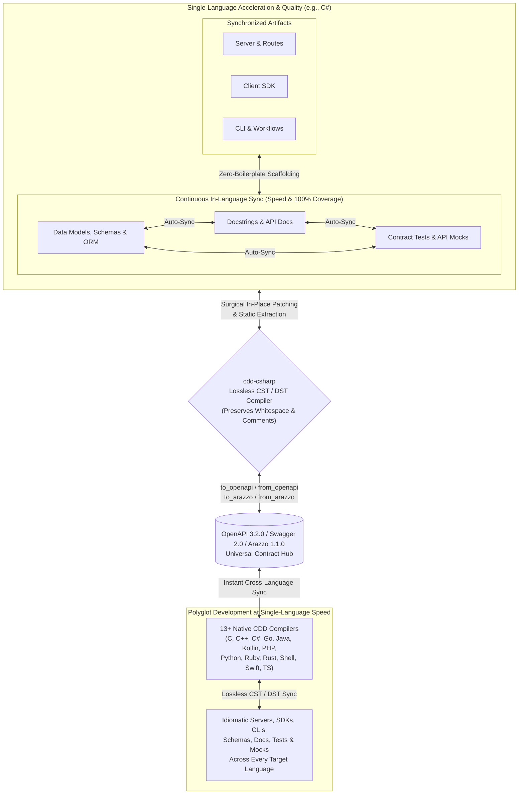

cdd-csharp: C# ⇄ OpenAPI
========================

[](https://opensource.org/licenses/Apache-2.0)
[](https://offscale.io/wasm_web_demo)
[](https://github.com/SamuelMarks/cdd-csharp/actions)
[](#)
[](#)

**cdd-csharp** compiles **[OpenAPI](https://spec.openapis.org/oas/latest.html) / [Swagger](https://spec.openapis.org/oas/v2.0.html) / [Arazzo](https://spec.openapis.org/arazzo/latest.html)** to and from **C#** (servers, client SDKs, CLIs, database schemas, tests, mocks, and docs), updating your existing code in-place without overwriting your edits.

**Compiler Driven Development (CDD)** is a software engineering methodology that uses a suite of standalone, lossless compilers to synchronize API specifications, server implementations, client SDKs, command-line tooling, workflow orchestrators, tests, and documentation.

Unlike traditional code generators that treat outputs as disposable or read-only, Compiler Driven Development provides a **complete, standalone compiler** (exposed as both a CLI and a programmatic SDK) written natively in each supported language. Where conventional compilers rely solely on an Abstract Syntax Tree (AST) that discards formatting and comments, CDD compilers operate on a **Concrete Syntax Tree (CST)** or **Decorated Syntax Tree (DST)**. This guarantees **lossless conversion**—preserving exact whitespace, indentation, inline comments, block comments, and docstrings—allowing true bidirectional synchronization between hand-edited `C#` source code and [OpenAPI 3.2.0](https://spec.openapis.org/oas/v3.2.0.html), [Swagger 2.0](https://spec.openapis.org/oas/v2.0.html), and [Arazzo 1.1.0](https://spec.openapis.org/arazzo/v1.1.0.html) specifications.

---

## Why Compiler Driven Development?

By replacing one-way templates and manual boilerplate with lossless CST/DST compilers, Compiler Driven Development transforms the engineering lifecycle across four dimensions:

- **Development Speed**: Eliminate manual boilerplate across servers, client SDKs, CLIs, database models, workflow runners, and mock servers. Start from an [OpenAPI](https://spec.openapis.org/oas/latest.html) or [Arazzo](https://spec.openapis.org/arazzo/latest.html) specification to scaffold an entire installable project (complete with package manifests and CI workflows), or write code first in `C#` and extract the specification automatically. When requirements change, update whichever representation is most convenient and synchronize the rest immediately.
- **Development Consistency**: Every data model, route handler, CLI flag, ORM entity, workflow step, and API contract is derived from and validated against the same semantic representation. Architectural drift between backend routes, frontend clients, and published specifications becomes structurally impossible.
- **Development Quality**: Keeping tests and documentation in lockstep with implementation code is automated rather than an afterthought. Because the compiler parses and emits docstrings, type signatures, API mocks, and contract test suites alongside your business logic, maintaining **100% documentation coverage and 100% test coverage** becomes a natural byproduct of compilation rather than a manual chore.
- **Polyglot Development**: Seamlessly bridge **13+ programming languages** (C, C++, C#, Go, Java, Kotlin, PHP, Python, Ruby, Rust, POSIX Shell, Swift, and TypeScript) to and from [OpenAPI](https://spec.openapis.org/oas/latest.html) and [Arazzo](https://spec.openapis.org/arazzo/latest.html) specifications. Any codebase in any supported language can be reverse-compiled into OpenAPI/Arazzo and immediately compiled forward into idiomatic, human-editable code across every other language in the suite. And being an open-source methodology—rather than a proprietary trade secret—new languages can be added by implementing new compilers that follow the CDD approach (see [cdd-spec-conformance](https://github.com/SamuelMarks/cdd-spec-conformance) for tooling to facilitate).

---

## The Standalone Compiler Architecture and Lossless Conversion

Traditional code generation tools rely on destructive templating: if you regenerate your project from an updated specification, your custom implementation logic, formatting, and comments are overwritten.

Each Compiler Driven Development toolchain is written natively in its target language, compiles both to native binaries and to **WebAssembly (WASM/WASI)**, and implements a full lexer, parser, semantic differ, and code emitter backed by Concrete Syntax Tree (CST) and Decorated Syntax Tree (DST) representations:

- **Beyond AST to CST/DST**: A standard Abstract Syntax Tree (AST) captures program semantics while stripping away "trivia" (whitespace, blank lines, and comments). By pairing structural AST semantics with a Concrete Syntax Tree (CST) or Decorated Syntax Tree (DST) that attaches trivia and structured documentation directly to syntax nodes, the compiler preserves 100% of your source formatting and comments.
- **Zero-Destruction Guarantee**: Every part of the generated codebase is designed to be edited by humans. You can open generated routing files, data models, database entities, workflow runners, tests, and CLI commands, format them to your preferences, add inline comments, and inject custom business logic.
- **When your specification changes**: The CDD compiler parses your existing source files into a CST/DST, computes a semantic diff against the updated [OpenAPI](https://spec.openapis.org/oas/latest.html) or [Arazzo](https://spec.openapis.org/arazzo/latest.html) specification, and surgically patches in new endpoints, workflows, parameters, or fields without disturbing your custom logic, comments, or whitespace.
- **When your codebase changes**: The compiler statically analyzes your updated source code, routes, workflows, tests, and docstrings—without unsafe dynamic code execution or reflection—to extract a 100% compliant, authoritative [OpenAPI](https://spec.openapis.org/oas/latest.html) or [Arazzo](https://spec.openapis.org/arazzo/latest.html) specification.

---

## The Bidirectional Synchronization Loop



The Compiler Driven Development lifecycle delivers compounding returns in both single-language and polyglot environments:
1. **Single-Language Speed**: Edit whichever artifact is most convenient—models/schemas, route handlers, docstrings, or tests—and let `cdd-csharp` surgically synchronize the rest in-place without overwriting your custom logic, comments, or whitespace.
2. **Single-Language Quality**: Because schemas, documentation, contract tests, and mocks are continuously cross-compiled rather than manually maintained, **100% doc coverage and 100% test coverage** are enforced automatically on every sync.
3. **Polyglot Development at Single-Language Speed**: Extracting an authoritative [OpenAPI](https://spec.openapis.org/oas/latest.html) or [Arazzo](https://spec.openapis.org/arazzo/latest.html) contract from one language immediately drives lossless forward-compilation across all 13+ supported languages—making multi-language SDK, CLI, and service maintenance just as fast as working in a single codebase.

---

## Core Capabilities Shared Across All CDD Compilers

Every `cdd-*` repository in the suite implements the same foundational feature set:

- **Bidirectional OpenAPI 3.2.0 & Swagger 2.0 Compilation**:
  - `from_openapi`: Generate idiomatic `C#` Client SDKs (`to_sdk`), Client CLIs (`to_sdk_cli`), and Server stubs/routers (`to_server`) from a single specification (`-i`) or a batch directory of specifications (`--input-dir`). Automatically upgrades legacy Swagger 2.0 and OpenAPI 3.0/3.1 specifications to OpenAPI 3.2.0.
  - `to_openapi`: Statically parse existing `C#` source files or directories to extract a compliant OpenAPI 3.2.0 specification.
- **Bidirectional Arazzo 1.1.0 Workflow Orchestration**:
  - `from_arazzo`: Compile multi-step [Arazzo 1.1.0](https://spec.openapis.org/arazzo/v1.1.0.html) workflow specifications (including runtime expressions, step DAGs, criterion evaluations, and failure/success actions) into `C#` SDK workflow orchestrators (`to_sdk`), CLI workflow runners (`to_sdk_cli`), and Server/E2E workflow test suites (`to_server`).
  - `to_arazzo`: Reverse-parse `C#` workflow orchestrators, CLI scripts, or E2E test suites back into an authoritative Arazzo 1.1.0 document.
- **In-Place Codebase Synchronization (`sync`)**:
  - Synchronize data models, ORM schemas, route handlers, docstrings, contract tests, mocks, and specifications in-place using lossless CST/DST patching.
- **Documentation Code-Snippet Generation (`to_docs_json`)**:
  - Emit a structured JSON documentation payload containing idiomatic `C#` request/workflow code snippets for every operation in an OpenAPI specification (with `--no-imports` and `--no-wrapping` options for embedding in documentation portals).
- **Composable Contract Tests, Mocks, CI, and Package Scaffolding**:
  - By default, `from_openapi` and `from_arazzo` scaffold complete, installable `C#` packages and `.github/workflows/ci.yml` pipelines (configurable via `--no-installable-package` and `--no-github-actions`), and generate contract test suites and API mocks/fakes via `--tests`.
- **Model Context Protocol (`mcp`) & JSON-RPC (`serve_json_rpc`)**:
  - Run `cdd-csharp mcp` to expose the compiler over stdio as an [MCP](https://modelcontextprotocol.io/) server for AI assistants and IDEs, or pass `--mcp` during generation to emit MCP tool/resource adapters directly inside generated SDKs and servers.
  - Run `cdd-csharp serve_json_rpc` to expose the compiler's full API over JSON-RPC 2.0 (`--port`, `--listen`).
- **Native CLI, Programmatic SDK, and WebAssembly (WASM/WASI)**:
  - Use `cdd-csharp` from the command line, import its programmatic SDK directly into `C#` applications, or run it in the browser and WASI runtimes via its WebAssembly build (see [WASM.md](WASM.md)).

---

## The Global Polyglot Ecosystem

Every supported language operates on the same core Compiler Driven Development principles and is powered by a dedicated, native compiler tailored to that language's syntax tree, idioms, and package manager.

All implementations expose a standardized command-line interface (`cdd-csharp <subcommand>`) and programmatic SDK.

| Repository | Language | Targets (`to_sdk`; `to_sdk_cli`; `to_server`) | Special Features Beyond Common Subset | Standards | CI Status |
|---|---|---|---|---|---|
| [`cdd-c`](https://github.com/SamuelMarks/cdd-c) | C (C89) | Client; Client CLI; Server | 42-Language FFI Generator (`bind`); GNU-to-C89 AST Lowering; Safe CRT & Memory Security Auditor; `c-orm` Migrations | [Arazzo 1.1.0](https://spec.openapis.org/arazzo/v1.1.0.html); [Swagger 2.0](https://spec.openapis.org/oas/v2.0.html); [OpenAPI 3.2.0](https://spec.openapis.org/oas/v3.2.0.html); [MCP](https://modelcontextprotocol.io/) | [](https://github.com/SamuelMarks/cdd-c/actions/workflows/ci.yml) |
| [`cdd-cpp`](https://github.com/SamuelMarks/cdd-cpp) | C++ | Client; Client CLI; Server | [Google Discovery](https://developers.google.com/discovery) (`from_google_discovery`); PostgreSQL `libpq` ORM & Faker Support | [Google Discovery](https://developers.google.com/discovery); [Arazzo 1.1.0](https://spec.openapis.org/arazzo/v1.1.0.html); [Swagger 2.0](https://spec.openapis.org/oas/v2.0.html); [OpenAPI 3.2.0](https://spec.openapis.org/oas/v3.2.0.html); [MCP](https://modelcontextprotocol.io/) | [](https://github.com/SamuelMarks/cdd-cpp/actions/workflows/ci.yml) |
| [`cdd-csharp`](https://github.com/SamuelMarks/cdd-csharp) | C# | Client; Client CLI; Server | CLR & Roslyn CST/DST Trivia-Preserving Sync; Entity Framework & Minimal API Targets | [Arazzo 1.1.0](https://spec.openapis.org/arazzo/v1.1.0.html); [Swagger 2.0](https://spec.openapis.org/oas/v2.0.html); [OpenAPI 3.2.0](https://spec.openapis.org/oas/v3.2.0.html); [MCP](https://modelcontextprotocol.io/) | [](https://github.com/SamuelMarks/cdd-csharp/actions/workflows/ci.yml) |
| [`cdd-go`](https://github.com/SamuelMarks/cdd-go) | Go | Client; Client CLI; Server | Go `dst`/`ast` Surgical Patching; Multi-Source Truth Sync (`code` ⇄ `openapi`) | [Arazzo 1.1.0](https://spec.openapis.org/arazzo/v1.1.0.html); [Swagger 2.0](https://spec.openapis.org/oas/v2.0.html); [OpenAPI 3.2.0](https://spec.openapis.org/oas/v3.2.0.html); [MCP](https://modelcontextprotocol.io/) | [](https://github.com/SamuelMarks/cdd-go/actions/workflows/ci.yml) |
| [`cdd-java`](https://github.com/SamuelMarks/cdd-java) | Java | Client; Client CLI; Server | JavaParser CST Lexical Preservation; WASI JSON-RPC Mode; In-Memory Compiler Pipeline | [Arazzo 1.1.0](https://spec.openapis.org/arazzo/v1.1.0.html); [Swagger 2.0](https://spec.openapis.org/oas/v2.0.html); [OpenAPI 3.2.0](https://spec.openapis.org/oas/v3.2.0.html); [MCP](https://modelcontextprotocol.io/) | [](https://github.com/SamuelMarks/cdd-java/actions/workflows/ci.yml) |
| [`cdd-kotlin`](https://github.com/offscale/cdd-kotlin) | Kotlin (Ktor Multiplatform) | Client; Client CLI; Server | Multiplatform Auto-Admin UI; Ephemeral & Seeded Mock Server Modes; Webhook Triggers | [Arazzo 1.1.0](https://spec.openapis.org/arazzo/v1.1.0.html); [Swagger 2.0](https://spec.openapis.org/oas/v2.0.html); [OpenAPI 3.2.0](https://spec.openapis.org/oas/v3.2.0.html); [MCP](https://modelcontextprotocol.io/) | [](https://github.com/offscale/cdd-kotlin/actions/workflows/ci.yml) |
| [`cdd-php`](https://github.com/SamuelMarks/cdd-php) | PHP | Client; Client CLI; Server | Multi-Tiered DAO (`StubDao` / `ConcreteDao`); Ephemeral & Faker-Seeded SQLite Server Modes | [Arazzo 1.1.0](https://spec.openapis.org/arazzo/v1.1.0.html); [Swagger 2.0](https://spec.openapis.org/oas/v2.0.html); [OpenAPI 3.2.0](https://spec.openapis.org/oas/v3.2.0.html); [MCP](https://modelcontextprotocol.io/) | [](https://github.com/SamuelMarks/cdd-php/actions/workflows/ci.yml) |
| [`cdd-python`](https://github.com/offscale/cdd-python) | Python | N/A (server building blocks) | CLI ⇄ SQLAlchemy ⇄ Pydantic ⇄ Docs ⇄ JSON Schema | N/A | [](https://github.com/offscale/cdd-python/actions) |
| [`cdd-python-all`](https://github.com/offscale/cdd-python-all) | Python | Client; Client CLI; Server | `LibCST` Lossless Sync; Multi-Truth Sync (`class`, `sqlalchemy`, `function`, `openapi`); FastAPI + SQLAlchemy | [Arazzo 1.1.0](https://spec.openapis.org/arazzo/v1.1.0.html); [Swagger 2.0](https://spec.openapis.org/oas/v2.0.html); [OpenAPI 3.2.0](https://spec.openapis.org/oas/v3.2.0.html); [MCP](https://modelcontextprotocol.io/) | [](https://github.com/offscale/cdd-python-all/actions/workflows/ci.yml) |
| [`cdd-ruby`](https://github.com/SamuelMarks/cdd-ruby) | Ruby | Client; Client CLI; Server | ActiveRecord Sync (`class`, `activerecord`, `function`); Ephemeral & Seeded Server Generation | [Arazzo 1.1.0](https://spec.openapis.org/arazzo/v1.1.0.html); [Swagger 2.0](https://spec.openapis.org/oas/v2.0.html); [OpenAPI 3.2.0](https://spec.openapis.org/oas/v3.2.0.html); [MCP](https://modelcontextprotocol.io/) | [](https://github.com/SamuelMarks/cdd-ruby/actions/workflows/ci.yml) |
| [`cdd-rust`](https://github.com/SamuelMarks/cdd-rust) | Rust | Client; Client CLI; Server | Actix-Web, Axum & Reqwest Targets; Diesel Schema Sync; Standalone `schema-gen`, `scaffold` & `test-gen` | [Arazzo 1.1.0](https://spec.openapis.org/arazzo/v1.1.0.html); [Swagger 2.0](https://spec.openapis.org/oas/v2.0.html); [OpenAPI 3.2.0](https://spec.openapis.org/oas/v3.2.0.html); [MCP](https://modelcontextprotocol.io/) | [](https://github.com/SamuelMarks/cdd-rust/actions/workflows/ci.yml) |
| [`cdd-sh`](https://github.com/SamuelMarks/cdd-sh) | Shell (`/bin/sh`) | Client; Client CLI; Server | Zero-Dependency Embedded `sh`/`jq`/`awk` Cross-Platform Binary; Direct AST `parse` & `emit` Subcommands | [Arazzo 1.1.0](https://spec.openapis.org/arazzo/v1.1.0.html); [Swagger 2.0](https://spec.openapis.org/oas/v2.0.html); [OpenAPI 3.2.0](https://spec.openapis.org/oas/v3.2.0.html); [MCP](https://modelcontextprotocol.io/) | [](https://github.com/SamuelMarks/cdd-sh/actions/workflows/ci.yml) |
| [`cdd-swift`](https://github.com/SamuelMarks/cdd-swift) | Swift | Client; Client CLI; Server | `SwiftSyntax` Lossless Merging (`merge_swift`); Vapor + Fluent ORM Scaffolding; `sync_arazzo` | [Arazzo 1.1.0](https://spec.openapis.org/arazzo/v1.1.0.html); [Swagger 2.0](https://spec.openapis.org/oas/v2.0.html); [OpenAPI 3.2.0](https://spec.openapis.org/oas/v3.2.0.html); [MCP](https://modelcontextprotocol.io/) | [](https://github.com/SamuelMarks/cdd-swift/actions/workflows/ci.yml) |
| [`cdd-ts`](https://github.com/offscale/cdd-ts) | TypeScript | Client; Client CLI; Server | Auto-Admin UI; Angular, React, Vue, Vanilla; Fetch, Axios, Node; Express, Bun, Deno; TypeORM Sync | [Arazzo 1.1.0](https://spec.openapis.org/arazzo/v1.1.0.html); [Swagger 2.0](https://spec.openapis.org/oas/v2.0.html); [OpenAPI 3.2.0](https://spec.openapis.org/oas/v3.2.0.html); [MCP](https://modelcontextprotocol.io/) | [](https://github.com/offscale/cdd-ts/actions/workflows/ci.yml) |

---

## Programmatic SDK & CLI Quickstart

Every `cdd-*` toolchain can be invoked either as a standalone CLI binary or imported as a native `C#` library.

### Minimal CLI Usage

```sh
# Print help and version
cdd-csharp --help
cdd-csharp --version

# Generate a C# Client SDK, Client CLI, or Server from an OpenAPI spec
cdd-csharp from_openapi to_sdk -i spec.json -o ./sdk --tests
cdd-csharp from_openapi to_sdk_cli -i spec.json -o ./cli --tests
cdd-csharp from_openapi to_server -i spec.json -o ./server --tests

# Extract an OpenAPI 3.2.0 spec from existing C# source code
cdd-csharp to_openapi -i ./src -o openapi.json

# Generate and extract Arazzo 1.1.0 multi-step workflows
cdd-csharp from_arazzo to_sdk -i workflow.arazzo.json -o ./workflows --tests
cdd-csharp from_arazzo to_sdk_cli -i workflow.arazzo.json -o ./workflow-cli --tests
cdd-csharp from_arazzo to_server -i workflow.arazzo.json -o ./workflow-server --tests
cdd-csharp to_arazzo -i ./workflows -o extracted.arazzo.json

# Synchronize codebase models, routes, tests, docs, and OpenAPI in-place
cdd-csharp sync -i ./src -o openapi.json

# Generate documentation-ready C# code snippets JSON for an OpenAPI spec
cdd-csharp to_docs_json --no-imports --no-wrapping -i spec.json -o docs.json

# Run as a Model Context Protocol (MCP) server over stdio or JSON-RPC 2.0 server
cdd-csharp mcp
cdd-csharp serve_json_rpc --port 8080 --listen 127.0.0.1
```

### Programmatic SDK Example

```csharp
using System.Collections.Generic;
using System.IO;
using Cdd.OpenApi;
using Cdd.OpenApi.Arazzo;
using Cdd.OpenApi.DocsJson;
using Cdd.OpenApi.Emit;
using Cdd.OpenApi.Models;
using Cdd.OpenApi.Parse;

// 1. Parse an OpenAPI 3.2.0 or Swagger 2.0 document and generate in-memory C# files
string specJson = File.ReadAllText("spec.json");
OpenApiDocument doc = new OpenApiParser().ParseJson(specJson);
List<GeneratedCode> files = CodeGenerator.Generate(
    doc,
    baseNamespace: "MyService",
    generateSdk: true,
    generateCli: true,
    generateServer: true,
    createComposableTestsAndMocks: true,
    generateMcp: true);

// 2. Scaffold or losslessly patch an installable C# project on disk
CddGenerator.GenerateServer(new CddConfig
{
    InputPath = "spec.json",
    OutputDir = "./generated-server",
    CreateComposableTestsAndMocks = true,
    Mcp = true
});

// 3. Reverse-compile existing C# source code back into an OpenAPI 3.2.0 specification
OpenApiDocument extractedSpec = SpecGenerator.Generate(new List<string> { File.ReadAllText("Models/Pet.cs") });
File.WriteAllText("openapi.json", new OpenApiEmitter().EmitJson(extractedSpec));

// 4. Compile Arazzo 1.1.0 workflows and generate documentation snippet JSON
ArazzoDocument arazzoDoc = ArazzoParser.ParseYamlOrJson(File.ReadAllText("workflow.arazzo.yaml"));
List<GeneratedCode> workflowFiles = ArazzoCodeGenerator.Generate(arazzoDoc);
string docsJson = DocsJsonGenerator.Generate(doc, noImports: true, noWrapping: true);
```

### Installation & Development

All `cdd-*` repositories support both native language build tools and a standardized cross-platform `Makefile` / `make.bat` interface (`deps`, `build`, `test`):

```sh
make deps
make build
make test
# or on Windows:
.\make.bat deps
.\make.bat build
.\make.bat test
```

```sh
# Install globally via NuGet
dotnet tool install --global cdd-csharp

# Restore, build, format-check, and run the test suite with the .NET SDK
dotnet restore CddOpenApi.slnx
dotnet build CddOpenApi.slnx -c Release
dotnet format whitespace CddOpenApi.slnx --verify-no-changes
dotnet test CddOpenApi.slnx /p:CollectCoverage=true

# Verify 100% XML documentation coverage
dotnet run --project scripts/DocCoverage.csproj src/Cdd.OpenApi
```

> **Further Documentation**:
> - [**ARCHITECTURE.md**](ARCHITECTURE.md) — Compiler pipeline (Lexer → CST/DST/AST → Semantic Diff → Emitter).
> - [**COMPLIANCE.md**](COMPLIANCE.md) — Swagger 2.0, OpenAPI 3.2.0, Arazzo 1.1.0, and MCP support matrices.
> - [**USAGE.md**](USAGE.md) — Detailed CLI, SDK, ORM, and roundtrip usage guide.
> - [**DEVELOPING.md**](DEVELOPING.md) — Local development, linting, testing, and coverage guide.
> - [**WASM.md**](WASM.md) — WebAssembly / WASI build and browser/Node.js execution instructions.
> - [**PUBLISH.md**](PUBLISH.md) — Package publishing and release workflow.

---

## Universal CLI Toolchain

Once you learn the Compiler Driven Development CLI in one language, you can use the exact same commands, flags, and environment variables across the entire polyglot stack.

### Common Arguments & Environment Variables

| Flag | Short | Environment Variable | Description |
|---|---|---|---|
| `--help` | `-h` | — | Print help information for the CLI or subcommand. |
| `--version` | `-v` / `-V` | — | Print version information. |
| `--input <path>` | `-i` / `-f` | `CDD_INPUT` | Path or URL to the input OpenAPI/Arazzo spec or source file/directory. |
| `--input-dir <dir>` | `-d` | `CDD_INPUT_DIR` | Directory containing multiple OpenAPI/Arazzo specifications for batch generation. |
| `--output <path>` | `-o` | `CDD_OUTPUT` | Destination file or directory path for generated code or extracted specifications. |
| `--tests` | `-t` | `CDD_TESTS` | Generate composable contract/integration tests and API mocks alongside code. |
| `--mcp` | `-m` | `CDD_MCP` | Generate Model Context Protocol (MCP) server and client adapters. |
| `--no-github-actions` | — | `CDD_NO_GITHUB_ACTIONS` | Do not generate `.github/workflows/ci.yml` scaffolding in target output. |
| `--no-installable-package` | — | `CDD_NO_INSTALLABLE_PACKAGE` | Do not generate package manifest/build files in target output. |
| `--no-imports` | — | `CDD_NO_IMPORTS` | (`to_docs_json`) Omit import/include statements from generated documentation snippets. |
| `--no-wrapping` | — | `CDD_NO_WRAPPING` | (`to_docs_json`) Omit boilerplate wrapper functions/classes from documentation snippets. |
| `--port <port>` | `-p` | `CDD_PORT` | (`serve_json_rpc`) TCP port to listen on (default: `8080`). |
| `--listen <addr>` | `-l` | `CDD_LISTEN` | (`serve_json_rpc`) Host/IP address to bind to (default: `127.0.0.1`). |
| `--truth <source>` | `-t` | `CDD_TRUTH` | (`sync`) Designate the single source of truth when synchronizing. |

### Core Subcommands

- **`from_openapi [to_sdk | to_sdk_cli | to_server]`**: Compile an OpenAPI 3.2.0 or Swagger 2.0 specification into an idiomatic `C#` Client SDK, Client CLI, or HTTP Server (patching existing files losslessly if the target directory already exists).
- **`to_openapi`**: Statically parse `C#` models, routes, client calls, and docstrings into an authoritative OpenAPI 3.2.0 specification.
- **`from_arazzo [to_sdk | to_sdk_cli | to_server]`**: Compile an Arazzo 1.1.0 workflow specification into `C#` workflow orchestrators, CLI workflow runners, or server/E2E workflow test suites.
- **`to_arazzo`**: Statically parse `C#` workflow code, CLI scripts, or E2E tests into an Arazzo 1.1.0 specification.
- **`sync`**: Bidirectionally synchronize `C#` source files (models, ORM entities, routes, functions, tests, and docstrings) with OpenAPI/Arazzo specifications in-place.
- **`to_docs_json`**: Generate documentation-optimized JSON containing `C#` code snippets for each operation in an OpenAPI specification.
- **`serve_json_rpc`**: Expose the `cdd-csharp` compiler over a JSON-RPC 2.0 server for IDE integrations and external tooling.
- **`mcp`**: Run the `cdd-csharp` compiler as a Model Context Protocol (MCP) server over standard I/O (`stdio`).

### Verbatim CLI Help Output

#### `cdd-csharp --help`

```text
Usage:
  cdd-csharp [subcommand] [options]

Subcommands:
  from_openapi    Generate code from an OpenAPI specification.
  to_openapi      Generate an OpenAPI specification from source code.
  from_arazzo     Generate code from an Arazzo 1.1.0 specification.
  to_arazzo       Generate an Arazzo 1.1.0 specification from source code.
  to_docs_json    Generate JSON documentation with code snippets for an OpenAPI specification.
  sync            Synchronize an OpenAPI specification with source code.
  serve_json_rpc  Expose CLI interface as a JSON-RPC server.
  mcp             Run the generator as an MCP server over stdio.
  parse           Parse and validate an OpenAPI specification.
  emit            Parse and re-emit an OpenAPI specification.

Options:
  --help, -h      Show this message
  --version, -v   Show version information

Examples:
  cdd-csharp from_openapi [to_sdk|to_sdk_cli|to_server] -i|--input <spec.json> | -d|--input-dir <dir> [-o|--output <output-dir>] [--no-github-actions] [--no-installable-package] [--tests] [-m|--mcp]
  cdd-csharp to_openapi -i|--input <csharp-dir-or-file> [-o|--output <output.json>]
  cdd-csharp from_arazzo [to_sdk|to_sdk_cli|to_server] -i|--input <spec.arazzo.json> | -d|--input-dir <dir> [-o|--output <output-dir>] [--no-github-actions] [--no-installable-package] [--tests]
  cdd-csharp to_arazzo -i|--input <csharp-dir-or-file> [-o|--output <output.arazzo.json>]
  cdd-csharp to_docs_json --no-imports --no-wrapping -i|--input <spec.json> [-o|--output docs.json]
  cdd-csharp serve_json_rpc [-p|--port <port>] [-l|--listen <address>]
```

#### `cdd-csharp from_openapi --help`

```text
Generate code from an OpenAPI specification.

Usage:
  cdd-csharp from_openapi [to_sdk|to_sdk_cli|to_server] -i <input> | -d|--input-dir <dir> [-o <output>]

Options:
  -i, --input                 Path or URL to the OpenAPI specification.
  -d, --input-dir             Directory containing OpenAPI specifications.
  -o, --output                Output file or directory path.
  --tests                     Generate integration tests and mocks.
  --no-github-actions         Do not generate GitHub Actions scaffolding.
  --no-installable-package    Do not generate installable package scaffolding.
  -m, --mcp                   Generate Model Context Protocol (MCP) server and adapter.
```

#### `cdd-csharp from_openapi to_sdk --help`

```text
Generate code from an OpenAPI specification.

Usage:
  cdd-csharp from_openapi [to_sdk|to_sdk_cli|to_server] -i <input> | -d|--input-dir <dir> [-o <output>]

Options:
  -i, --input                 Path or URL to the OpenAPI specification.
  -d, --input-dir             Directory containing OpenAPI specifications.
  -o, --output                Output file or directory path.
  --tests                     Generate integration tests and mocks.
  --no-github-actions         Do not generate GitHub Actions scaffolding.
  --no-installable-package    Do not generate installable package scaffolding.
  -m, --mcp                   Generate Model Context Protocol (MCP) server and adapter.
```

#### `cdd-csharp from_openapi to_sdk_cli --help`

```text
Generate code from an OpenAPI specification.

Usage:
  cdd-csharp from_openapi [to_sdk|to_sdk_cli|to_server] -i <input> | -d|--input-dir <dir> [-o <output>]

Options:
  -i, --input                 Path or URL to the OpenAPI specification.
  -d, --input-dir             Directory containing OpenAPI specifications.
  -o, --output                Output file or directory path.
  --tests                     Generate integration tests and mocks.
  --no-github-actions         Do not generate GitHub Actions scaffolding.
  --no-installable-package    Do not generate installable package scaffolding.
  -m, --mcp                   Generate Model Context Protocol (MCP) server and adapter.
```

#### `cdd-csharp from_openapi to_server --help`

```text
Generate code from an OpenAPI specification.

Usage:
  cdd-csharp from_openapi [to_sdk|to_sdk_cli|to_server] -i <input> | -d|--input-dir <dir> [-o <output>]

Options:
  -i, --input                 Path or URL to the OpenAPI specification.
  -d, --input-dir             Directory containing OpenAPI specifications.
  -o, --output                Output file or directory path.
  --tests                     Generate integration tests and mocks.
  --no-github-actions         Do not generate GitHub Actions scaffolding.
  --no-installable-package    Do not generate installable package scaffolding.
  -m, --mcp                   Generate Model Context Protocol (MCP) server and adapter.
```

#### `cdd-csharp to_openapi --help`

```text
Usage:
  cdd-csharp to_openapi -i <input> [-o <output>]

Options:
  -i, --input    Path to source code directory or file.
  -o, --output   Output file or directory path.
```

#### `cdd-csharp from_arazzo --help`

```text
Generate code from an Arazzo 1.1.0 specification.

Usage:
  cdd-csharp from_arazzo [to_sdk|to_sdk_cli|to_server] -i <input> | -d|--input-dir <dir> [-o <output>]

Options:
  -i, --input                 Path to the Arazzo specification.
  -d, --input-dir             Directory containing Arazzo specifications.
  -o, --output                Output directory path.
  --tests                     Generate workflow integration tests and mocks.
  --no-github-actions         Do not generate GitHub Actions scaffolding.
  --no-installable-package    Do not generate installable package scaffolding.
```

#### `cdd-csharp from_arazzo to_sdk --help`

```text
Generate code from an Arazzo 1.1.0 specification.

Usage:
  cdd-csharp from_arazzo [to_sdk|to_sdk_cli|to_server] -i <input> | -d|--input-dir <dir> [-o <output>]

Options:
  -i, --input                 Path to the Arazzo specification.
  -d, --input-dir             Directory containing Arazzo specifications.
  -o, --output                Output directory path.
  --tests                     Generate workflow integration tests and mocks.
  --no-github-actions         Do not generate GitHub Actions scaffolding.
  --no-installable-package    Do not generate installable package scaffolding.
```

#### `cdd-csharp from_arazzo to_sdk_cli --help`

```text
Generate code from an Arazzo 1.1.0 specification.

Usage:
  cdd-csharp from_arazzo [to_sdk|to_sdk_cli|to_server] -i <input> | -d|--input-dir <dir> [-o <output>]

Options:
  -i, --input                 Path to the Arazzo specification.
  -d, --input-dir             Directory containing Arazzo specifications.
  -o, --output                Output directory path.
  --tests                     Generate workflow integration tests and mocks.
  --no-github-actions         Do not generate GitHub Actions scaffolding.
  --no-installable-package    Do not generate installable package scaffolding.
```

#### `cdd-csharp from_arazzo to_server --help`

```text
Generate code from an Arazzo 1.1.0 specification.

Usage:
  cdd-csharp from_arazzo [to_sdk|to_sdk_cli|to_server] -i <input> | -d|--input-dir <dir> [-o <output>]

Options:
  -i, --input                 Path to the Arazzo specification.
  -d, --input-dir             Directory containing Arazzo specifications.
  -o, --output                Output directory path.
  --tests                     Generate workflow integration tests and mocks.
  --no-github-actions         Do not generate GitHub Actions scaffolding.
  --no-installable-package    Do not generate installable package scaffolding.
```

#### `cdd-csharp to_arazzo --help`

```text
Usage:
  cdd-csharp to_arazzo -i <input> [-o <output>]

Options:
  -i, --input    Path to C# workflow source code directory or file.
  -o, --output   Output Arazzo specification file path (JSON or YAML).
```

#### `cdd-csharp sync --help`

```text
Usage:
  cdd-csharp sync -t <truth> -i <input> [-o <output>]

Options:
  -t, --truth    Designate a single source of truth for synchronization.
  -i, --input    Path to the source files.
  -o, --output   Output file or directory path.
```

#### `cdd-csharp to_docs_json --help`

```text
Usage:
  cdd-csharp to_docs_json -i <input> [-o <output>]

Options:
  -i, --input    Path or URL to the OpenAPI specification.
  -o, --output   Output file or directory path.
  --no-imports   Omit the imports field.
  --no-wrapping  Omit the wrapper fields.
```

#### `cdd-csharp serve_json_rpc --help`

```text
Usage:
  cdd-csharp serve_json_rpc [-p <port>] [-l <listen>]

Options:
  -p, --port     Port to listen on (default: 8080).
  -l, --listen   Address to listen on (default: 127.0.0.1).
```

#### `cdd-csharp mcp --help`

```text
Usage:
  cdd-csharp mcp

Options:
  Run the generator as an MCP server over stdio.
```

#### `cdd-csharp parse --help`

```text
Usage:
  cdd-csharp parse <input>

Options:
  <input>    Path to the OpenAPI specification to parse and inspect.
```

#### `cdd-csharp emit --help`

```text
Usage:
  cdd-csharp emit <input> <output>

Options:
  <input>    Path to the input OpenAPI specification.
  <output>   Path to write the re-emitted OpenAPI JSON.
```

---

## Special Features Beyond the Common Compiler Driven Development Subset

While all compilers in this suite implement the full shared baseline above, `cdd-csharp` implements additional capabilities tailored to the `C#` ecosystem:

- **Roslyn CST/DST Trivia-Preserving Surgical Patching (`Cdd.OpenApi.Classes`, `Routes`, `Clients`, `CliModule`, `Orm`, `TestsModule`, `Mocks`, `Docstrings`)**:
  - Uses the .NET Compiler Platform (`Microsoft.CodeAnalysis.CSharp` / Roslyn) to parse and manipulate `ClassDeclarationSyntax`, `InterfaceDeclarationSyntax`, `RecordDeclarationSyntax`, `StructDeclarationSyntax`, `EnumDeclarationSyntax`, `MethodDeclarationSyntax`, and `PropertyDeclarationSyntax`.
  - Preserves leading and trailing syntax trivia, inline/block comments, custom method bodies, and structured XML documentation tags (`/// <summary>`, `<param>`, `<returns>`, `<remarks>`, `<example>`, `<title>`, `<version>`) when updating existing `.cs` files in-place (`CddGenerator`).
- **WASM-Safe Iterative Roslyn Walker & Formatter (`WasmSafeRoslyn` & `WasmSafeFormatter`)**:
  - Replaces Roslyn's deeply recursive syntax walkers and `NormalizeWhitespace()` with stack-based iterative AST/CST traversal (`GetDescendantNodesSafe`) and token formatting (`FormatSafe` / `WasmSafeFormatter.Format`).
  - Eliminates call-stack exhaustion inside the Mono WebAssembly interpreter in V8/browsers and `wasmtime` WASI environments (see [WASM.md](WASM.md)).
- **ASP.NET Core Minimal APIs & MVC Controller Targets (`ServerRoutesGenerator`, `ServerEntrypointGenerator`, `Routes`)**:
  - Emits modular ASP.NET Core Minimal API route extension classes (`Map<Tag>Routes` with `app.MapGet`, `app.MapPost`, `app.MapPut`, `app.MapDelete`, `app.MapPatch`, `app.MapOptions`) wired into a complete `WebApplication` entrypoint (`Program.cs`).
  - Supports bidirectional parsing and emission of ASP.NET Core MVC controller interfaces and attributes (`[ApiController]`, `[Route]`, `[HttpGet]`, `[HttpPost]`, `[HttpPut]`, `[HttpDelete]`, `[HttpPatch]`, `[FromRoute]`, `[FromQuery]`, `[FromHeader]`, `[FromBody]`).
- **Entity Framework Core ORM, Multi-Tiered DAOs (`StubDao` & `EfDao`), and Topological Fake Data Seeding (`Cdd.OpenApi.Orm`)**:
  - Generates EF Core `AppDbContext` (`DbContext`, `DbSet<T>`), `IDesignTimeDbContextFactory<AppDbContext>`, and `I<Entity>Dao` contracts registered via `DaoExtensions.AddDaos`.
  - Provides both `Stub<Entity>Dao` (zero-configuration stub tier) and `Ef<Entity>Dao` (concrete EF Core tier supporting both in-memory SQLite via `Microsoft.EntityFrameworkCore.Sqlite` and PostgreSQL via `Npgsql.EntityFrameworkCore.PostgreSQL`).
  - Generates `FakeDataSeeder` powered by `Bogus.Faker`, which constructs a schema dependency graph and topologically sorts OpenAPI schemas (`OrderSchemasByDependency`) so parent entities are seeded before foreign-key dependents.
- **Generated Server Runtime Modes, Mock Auth IDP, Validation, and Webhook Triggers**:
  - Servers generated via `from_openapi to_server` include built-in CLI flags and environment variable bindings (`ServerConfiguration.FromEnvironment()`):
    - `--ephemeral` / `EPHEMERAL_DB=true`: Runs against an auto-initialized in-memory SQLite database (`AppInitializer.InitializeAsync`).
    - `--seed`: Populates the database on startup using the topological `FakeDataSeeder`.
    - `DATABASE_URL`: Connects the EF Core `AppDbContext` to a PostgreSQL or external database instance.
    - `--strict-validation` / `TEST_STRICT_VALIDATION=true`: Enables strict request format validation middleware.
    - `--enforce-auth` / `TEST_ENFORCE_AUTH=true`: Enforces bearer token authentication middleware (`401 Unauthorized` on unauthenticated requests).
    - `--start-auth-server` / `TEST_START_AUTH_SERVER=true`: Mounts `/auth/register` and `/auth/login` mock Identity Provider (IDP) endpoints.
    - `/_mock/trigger-webhook/{webhook_name}`: Built-in webhook trigger endpoint accompanied by `WebApplicationFactory<Program>` integration tests (`AdvancedMockTests`).
- **Multi-Source Truth Synchronization (`sync --truth`)**:
  - `cdd-csharp sync -t|--truth <truth> -i <input> -o <output>` supports `--truth class`, `--truth function`, `--truth openapi`, `--truth arazzo`, and `--truth workflow` to synchronize between C# models/controllers, C# Arazzo workflow classes, OpenAPI 3.2.0, and Arazzo 1.1.0.
- **NativeAOT, Trimmer, and Browser `[JSExport]` Interop (`BrowserInterop`, `*JsonContext`)**:
  - Uses `System.Text.Json` source generators (`OpenApiJsonContext`, `ArazzoJsonContext`, `DocsJsonContext`) and `TrimmerRoots.xml` for reflection-free serialization compatible with NativeAOT and ILLink trimming.
  - Exposes `[JSExport]` entrypoints in `Cdd.OpenApi.Cli.BrowserInterop` (`FromOpenApi`, `ToOpenApi`, `ToDocsJson`, `FromArazzo`, `ToArazzo`) for direct in-memory execution in browser WebAssembly demos without a virtual filesystem.
  - Supports fallback CLI argument loading via `.cdd_args` and environment variables (`CDD_COMMAND`, `CDD_ARGS`, `INPUT`, `INPUT_FILE`, `INPUT_DIR`, `OUTPUT_DIR`, `OUTPUT_FILE`) for constrained WASI runtimes.
- **Direct `parse` & `emit` Subcommands and Extended MCP Tooling**:
  - Provides `cdd-csharp parse <input>` and `cdd-csharp emit <input> <output>` for direct OpenAPI document inspection and canonical JSON emission.
  - The `mcp` stdio server exposes six tools (`cdd_generate`, `cdd_inspect`, `cdd_extract`, `cdd_generate_in_memory`, `cdd_from_arazzo`, `cdd_to_arazzo`), prompts (`cdd_prompt`), and inspectable resources (`cdd://schema` and `cdd://ast`).

---

## The End of Specification Drift

With Compiler Driven Development, API specifications, source code, database schemas, documentation, and tests are no longer loosely coupled artifacts that drift apart over time. Because the compiler preserves every comment, docstring, and whitespace token via Concrete and Decorated Syntax Trees (CST/DST), your specifications and your implementations remain strict, lossless reflections of one another across all 13+ languages throughout the entire software lifecycle.

---

## License

Licensed under either of

- Apache License, Version 2.0 ([LICENSE-APACHE](LICENSE-APACHE) or <https://www.apache.org/licenses/LICENSE-2.0>)
- MIT license ([LICENSE-MIT](LICENSE-MIT) or <https://opensource.org/licenses/MIT>)

at your option.

### Contribution

Unless you explicitly state otherwise, any contribution intentionally submitted
for inclusion in the work by you, as defined in the Apache-2.0 license, shall be
dual licensed as above, without any additional terms or conditions.
